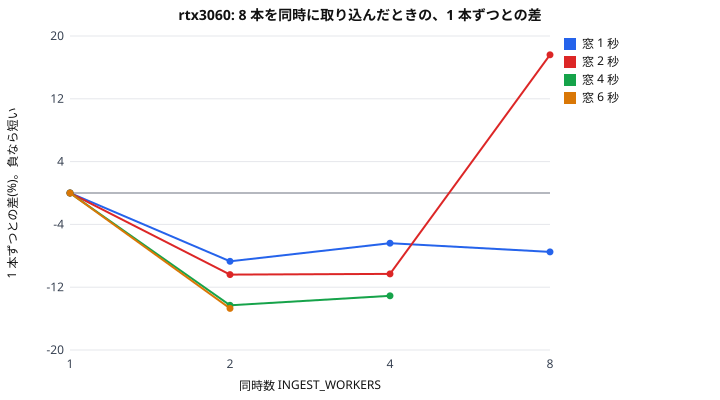
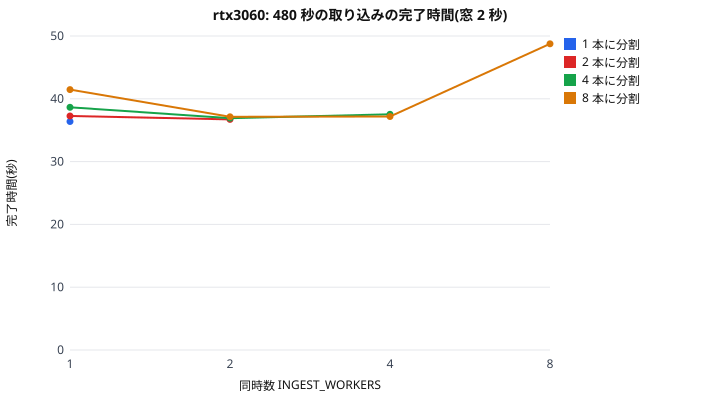
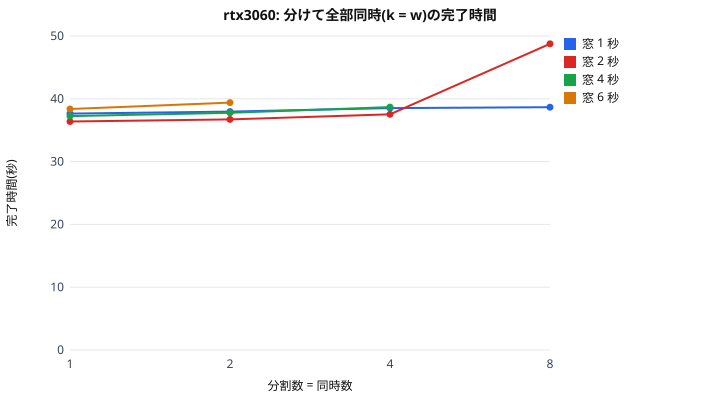
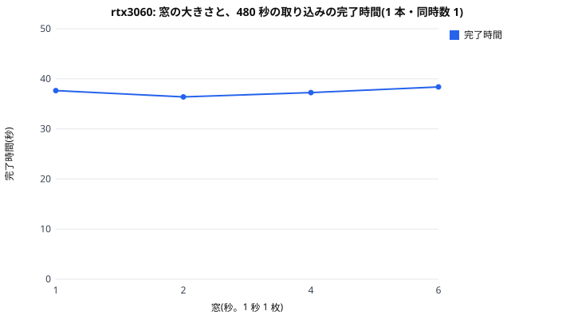
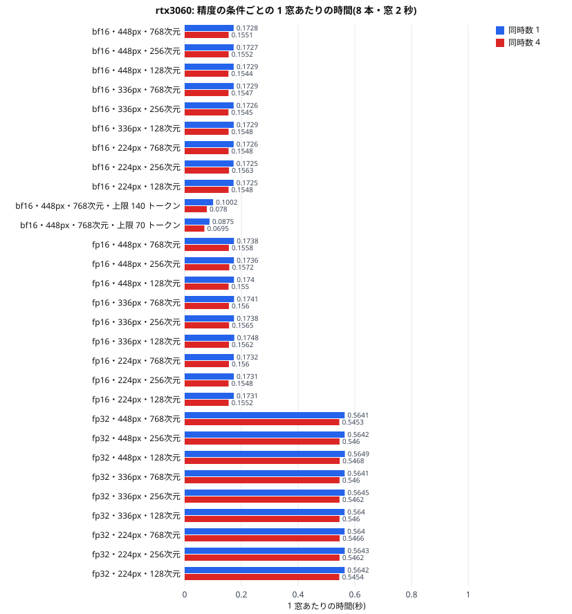
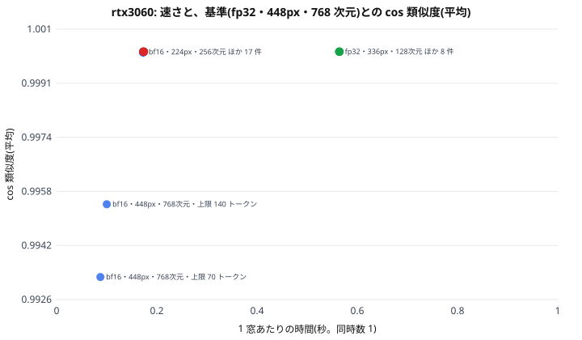

# ベンチマーク(速度と資源の使用率)

起動中の mediasearch に負荷をかけながら、1 秒ごとに資源の使用状況を記録し、**どこがボトルネックか**、**資源を使い切れているか**を判断するためのツールです。

- Python 3.10 以上の標準ライブラリだけで動きます(追加のインストールは不要)。サーバーと別のマシンからでも実行できます。
- コンテナイメージには含めません。リポジトリを取得して、`bench/` から実行してください。
- 複数の機種で同じ条件で比べる共通のベンチマーク(同時取り込み × 分割 × 窓 × 精度)の決まりは [MATRIX.md](MATRIX.md) にあります(Google Colab の GPU では [matrix_colab.ipynb](matrix_colab.ipynb) で計測できます)。
- サーバー側は `GET /api/metrics`(分離構成の推論側は `GET /compute/metrics`)で使用状況を返します。`API_TOKEN` を設定している場合は `--token` で渡します。

## 1. 計測用の素材を作る(任意)

実在の映像を使わずに、同じ条件で繰り返し計測できるよう、合成の映像・音声・画像を作れます(ffmpeg が必要)。

```bash
python bench/make_samples.py ./bench-media               # 1080p・720p の 60 秒(音声つき)、音声 60 秒、画像 50 枚
python bench/make_samples.py ./bench-media --seconds 300 # 長い動画で計測する
```

作ったフォルダを、サーバーの `/recordings` などにマウントします。

```bash
docker run --rm -p 8000:8000 --stop-timeout 60 -v ./data:/data -v ./bench-media:/recordings:ro \
  ghcr.io/miyabiver39/embeddinggemma-poc:cpu
```

## 2. 計測する

| シナリオ | 内容 | 例 |
|---|---|---|
| `ingest` | 動画・音声の取り込み(同じファイルを `--repeat` 回取り込み直し、中央値を出す) | `python bench/bench.py ingest --path /recordings/20260101_090000_1080p_60s.mp4 --repeat 3` |
| `images` | フォルダの画像の取り込み(枚/秒) | `python bench/bench.py images --dir /recordings/images` |
| `search` | 文章の検索の応答時間(p50 / p95 / p99)と処理量。`--during-ingest` で取り込み中の検索を測る | `python bench/bench.py search --concurrency 4 --duration 30 --during-ingest /recordings/...mp4` |
| `stream` | RTSP の受信(窓の作成の速さ・捨てた窓・遅れ)。終わったら登録と窓を削除する(`--keep` で残す) | `python bench/bench.py stream --rtsp rtsp://192.168.1.10/stream1 --duration 120` |
| `monitor` | 負荷はかけず、計測だけ行う(取り込みや検索は WebUI など別の手段で行う) | `python bench/bench.py monitor --duration 60` |

共通のオプション:

| オプション | 内容 |
|---|---|
| `--url` | サーバーの URL(既定 `http://localhost:8000`。環境変数 `MEDIASEARCH_URL` でも可) |
| `--token` | `API_TOKEN`(環境変数 `MEDIASEARCH_TOKEN` でも可) |
| `--compute-url` / `--compute-token` | 分離構成(app + compute)のとき、推論側の資源も計測する |
| `--interval` | 計測の間隔(秒。既定 1) |
| `--label` | 結果のフォルダ名に付ける名前(比較のときに分かりやすくする。例 `batch8`) |
| `--out` | 結果の保存先(既定 `bench/results/`。git の管理外) |
| `--preset` / `--window-sec` / `--frames-per-window` / `--overlap-sec` / `--audio` | 取り込みの窓の設定(`ingest` と `stream`) |

## 3. 結果を見る

`bench/results/<日時>-<シナリオ>[-<名前>]/` に保存します。

| ファイル | 内容 |
|---|---|
| `report.html` | 結果の画面(ブラウザで開く。外部への通信なし)。速度、診断、時間の推移のグラフ、CPU を使った処理の内訳、集計の表 |
| `result.json` | シナリオの結果・集計・診断・サーバーの設定 |
| `timeseries.csv` | 計測の間隔ごとの使用率(表計算ソフトで開ける) |
| `samples.jsonl` | `/api/metrics` の生の値(後から別の集計をするとき) |

設定を変えた前後の比較:

```bash
python bench/compare.py bench/results/20261012-100000-ingest-batch1 bench/results/20261012-101500-ingest-batch8
```

## 4. 計測している項目と、読み方

| 項目 | 取り方 | 読み方 |
|---|---|---|
| 推論の稼働率 | 推論が動いていた時間 ÷ 経過時間(推論は 1 件ずつ実行するため、順番待ちの制御で積算) | **100% に近ければ推論が律速**。推論を速くする(GPU・まとめ処理・窓の設定)と全体が速くなる |
| GPU 使用率・GPU メモリ | `nvidia-smi`(NVIDIA)、amdgpu の sysfs(AMD) | 推論の稼働率が高いのに GPU 使用率が低い → GPU を使い切れていない(`EMBED_BATCH` を上げる、CPU 側の前処理を確認) |
| GPU の動画復号回路の使用率 | `nvidia-smi` の decoder | 0% なら動画の復号は CPU で行われている(`FFMPEG_HWACCEL`) |
| CPU 使用率 | コンテナ全体(cgroup)の CPU 時間 ÷ 使える CPU の数 | 90% 以上なら CPU が飽和。`--cpus` の上限があれば、その数に対する割合 |
| CPU の上限で止められた時間 | cgroup の throttled | 大きければ、コンテナの CPU の上限(`--cpus`)で止められている |
| CPU の内訳 | スレッドごと(`native` = PyTorch の演算、`ingestor` = ファイルの取り込み、`stream` = RTSP、`decode` = フレームの受け取り、`worker` = API)と、ffmpeg などの子プロセス | 何が CPU を使っているか。ffmpeg が多ければ復号の負荷が高い |
| メモリ | アプリ本体の RSS、コンテナ全体(キャッシュを除く) | 上限に近ければ注意。ベクトル DB はメモリに載る(1 窓約 3.2KB) |
| ディスク | cgroup またはプロセスの読み書きの量 | 多ければディスクが律速の可能性 |
| 検索の待ち | 検索が推論の順番を待った時間 | 取り込み中は、実行中の取り込みの推論(1 窓分)を待つことがある。p99 が大きいのはこのため |
| 窓の作成・ストリームの遅れ・捨てた窓 | `/api/metrics` の index と streams | ストリームで捨てた窓があれば、推論が実時間に追いついていない |
| 処理時間の内訳 | ジョブの `timings`(probe / decode / audio / embed / store / thumb) | decode の割合が大きければ復号が律速、embed が大きければ推論が律速 |

診断(`report.html` の「診断」と、実行の最後の表示)は、これらの値から次のように判断します。

- 推論の稼働率が 85% 以上 → 推論が律速。CPU なら GPU の利用を、GPU なら使用率に応じて `EMBED_BATCH` の調整を案内
- 推論の稼働率が低く、処理時間の 30% 以上が復号の待ち → 復号が律速(`FFMPEG_HWACCEL`、`FFMPEG_SKIP_FRAMES`)
- CPU 使用率 90% 以上、CPU の上限で止められた時間 5% 以上、メモリ・GPU メモリが上限の 90% 以上、ストリームで窓を捨てた、検索の待ちが 1 秒を超えた → それぞれ注意として表示

## 5. 計測の例(GPU なし・CPU 3 コアに制限・実モデル・2026-10-12)

| シナリオ | 結果 | 診断 |
|---|---|---|
| `ingest`(20 秒の動画・2 秒窓) | 130.8 秒(1 窓 13.1 秒、実時間比 0.15) | 推論が律速(稼働率 98%)。CPU 98%(上限 3 コアで 73% の時間止められている)。CPU の内訳は PyTorch の演算 2.2 コア・取り込み 0.7 コア |
| `search --during-ingest`(並行 2) | 4.2 件/秒、p50 329 ms、p99 12.7 秒 | 取り込みの推論 1 窓分(約 13 秒)を待つことがあるため、p99 が大きい |
| `stream`(1080p の RTSP・60 秒) | 窓 7 件・捨てた窓 15 件 | 推論が実時間に追いつかない(CPU では 1 窓 2 秒以内に推論できない) |

ダミー推論(推論を省いた計測)では、60 秒・1080p の取り込みで、処理時間の 81% が復号の待ちになり「復号が律速」と判断されます。

### CPU(Ryzen 7 5700X)と GPU(RX 9060 XT 16GB / RTX 3060 12GB)の比較

素材は `make_samples.py` の既定(60 秒)。取り込みは 3 回の中央値。まとめる件数(`EMBED_BATCH`)は既定(GPU は 4)。

- CPU・RX 9060 XT(2026-10-13): Windows 11 + Docker Desktop(WSL2)。CPU は `:cpu`(制限なし・16 スレッド)、GPU は `:rocm`(`/dev/dxg`。`docs/gpu.md`)
- RTX 3060(2026-11-19 に測り直し): Ubuntu 26.04.1 LTS(Core i7-6700K・メモリ 22GB)、ドライバ 595.99.02。`:cuda`(main の 056b937。`--gpus all`)。画像と検索は 3 回の中央値。同じマシンでほかのサービスのコンテナも動いている状態で計測

| シナリオ | CPU(Ryzen 7 5700X) | RX 9060 XT(WSL2) | RTX 3060(Linux) |
|---|---|---|---|
| `ingest`(1080p・60 秒・2 秒窓 30 件) | 215.8 秒(1 窓 7.19 秒、実時間比 0.28) | 7.8 秒(1 窓 0.26 秒、実時間比 7.72) | 9.4 秒(1 窓 0.31 秒、実時間比 6.36) |
| `ingest`(音声 60 秒・10 秒区切り 6 件) | 5.17 秒(1 件 0.86 秒) | 0.91 秒(1 件 0.15 秒) | 1.01 秒(1 件 0.17 秒) |
| `images`(1080p の画像 50 枚) | 0.29 枚/秒 | 5.62 枚/秒 | 5.12 枚/秒 |
| `search`(並行 4・30 秒) | 7.1 件/秒、p50 440 ms / p95 1297 ms | 16.9 件/秒、p50 176 ms / p95 590 ms | 17.4 件/秒、p50 166 ms / p95 585 ms |

- いずれも推論が処理時間の大半を占めます(1080p の取り込みで、推論は CPU 215.0 秒・RTX 3060 8.1 秒。復号は 0.5 秒前後)。
- CPU は PyTorch が物理コア数(8)のスレッドで動くため、CPU 使用率は約 48% で頭打ちになります。
- RX 9060 XT は、高速な注意機構を有効にした状態(`rocm` イメージの既定。`docs/gpu.md`)の値です。無効のままでは 1080p の取り込みが 1 窓 1.03 秒、画像が 1.76 枚/秒でした。
- 音声と検索(短い文章)は 1 回の計算が小さいため、GPU による差が出にくくなります。
- RTX 3060 は動画の復号も GPU(NVDEC)で行います(`decoder: cuda`)。WSL2 の AMD は CPU で復号します。
- GPU はどちらも実時間より速く取り込めるため、2 秒窓の RTSP を実時間で処理できる見込みです(`stream` は未計測)。
- GPU の 1 回目の取り込みは、カーネルの準備のため遅くなることがあります(RX 9060 XT の音声で 5.3 秒。2 回目以降 1 秒弱。RTX 3060 では、起動後 1 回目の画像の取り込みが 3.88 枚/秒、音声が 1.79 秒)。
- RTX 3060 の GPU メモリ(使用量の最大)は約 3.1GB でした。12GB に対して余裕があります。
- RTX 3060 の 2026-10-13 の計測(Ubuntu 24.04)は、1 窓 0.29 秒・画像 4.85 枚/秒・検索 18.4 件/秒で、今回とほぼ同じでした。

### RTX 3060 12GB: 推論の高速化の前後(2026-11-20)

同じマシン・同じ素材で、高速化の前(公開中の `:cuda`。main の 056b937)と後(`docs/gpu.md` の「推論の高速化(NVIDIA)」)を続けて計測しました。
高速化の後は、`:cuda` に gcc を足したイメージに、この変更のソースを重ねて動かしています(CI でビルドする `cuda` イメージと同じ構成)。
取り込みは 3 回の中央値、画像と検索(並行 4)は 3 回の中央値です。

| シナリオ | 高速化の前 | 高速化の後 |
|---|---|---|
| `ingest`(1080p・60 秒・2 秒窓 30 件) | 9.45 秒(1 窓 0.315 秒、実時間比 6.35) | **5.27 秒(1 窓 0.176 秒、実時間比 11.39)** |
| `ingest`(音声 60 秒・10 秒区切り 6 件) | 1.00 秒 | **0.67 秒** |
| `images`(1080p の画像 50 枚) | 4.89 枚/秒 | **6.64 枚/秒** |
| `search`(並行 1・15 秒) | 19.2 件/秒、p50 51 ms | **130 件/秒、p50 7.6 ms** |
| `search`(並行 4・30 秒) | 18.0 件/秒、p50 155 ms / p95 564 ms | **194 件/秒、p50 19 ms / p95 35 ms** |
| `search`(並行 8・15 秒) | 18.5 件/秒、p50 318 ms | **274 件/秒、p50 29 ms** |
| `search --during-ingest`(並行 4・20 秒) | 17.3 件/秒、p50 162 ms / p99 1107 ms | **163 件/秒、p50 19 ms / p99 50 ms** |
| 起動(`/healthz` が応答するまで) | 20 秒 | 初回 80 秒、2 回目以降 32 秒 |
| GPU メモリ(使用量の最大) | 約 3.0GB | 約 3.4GB |

- 取り込みの推論(`embed`)は 8.1 秒 → 4.6 秒。推論の稼働率は約 75%、GPU 使用率は約 73% で、残りは動画の情報の読み取りと ffmpeg の起動の待ちです。
- 検索は、推論が 1 件 約 5 ms になり、HTTP・DB の処理(1 つのプロセスの Python。アプリ全体で約 1.2 コア)が律速になりました。並行 16 では 366 件/秒です。
- 画像の取り込みは、推論の稼働率が約 41% で、画像の読み込み(JPEG の復号と縮小)が律速です。

### RTX 3060 12GB: CI でビルドしたイメージでの計測と、PR #14 の前後(2026-11-20)

CI がビルドして公開した `:cuda` を、同じマシン・同じ素材で続けて計測しました。
変更前は main の 3a44a24(推論の高速化を入れた版)、変更後は main の c5a27c3(PR #14「推論の優先度キュー化・動画取り込みパイプライン・キャッシュ永続化/ウォームアップ・前処理最適化」を入れた版)です。
取り込みは 3 回の中央値、画像と検索(並行 4)は 3 回の中央値、そのほかは 1 回です。

| シナリオ | 変更前(3a44a24) | 変更後(c5a27c3) |
|---|---|---|
| `ingest`(1080p・60 秒・2 秒窓 30 件) | 5.23 秒(1 窓 0.174 秒、実時間比 11.47) | 5.24 秒(1 窓 0.175 秒、実時間比 11.46) |
| `ingest`(音声 60 秒・10 秒区切り 6 件) | 0.46 秒 | 0.44 秒 |
| `images`(1080p の画像 50 枚) | 9.63 枚/秒 | 9.67 枚/秒 |
| `search`(並行 1・15 秒) | 131 件/秒、p50 7.5 ms | 132 件/秒、p50 7.5 ms |
| `search`(並行 4・30 秒) | 193 件/秒、p50 19.0 ms / p95 34.4 ms | 194 件/秒、p50 18.9 ms / p95 35.2 ms |
| `search`(並行 8・15 秒) | 276 件/秒、p50 29.0 ms | 281 件/秒、p50 28.8 ms |
| `search`(並行 16・15 秒) | 370 件/秒、p50 43.0 ms | 361 件/秒、p50 44.1 ms |
| `search --during-ingest`(並行 4・20 秒) | 157 件/秒、p50 19.0 ms / p99 56 ms | 158 件/秒、p50 18.5 ms / p99 57 ms |
| 起動(`/healthz` が応答するまで) | 初回 82 秒、2 回目以降 39 秒 | 初回 82 秒、2 回目以降 37 秒 |
| GPU メモリ(使用量の最大) | 約 3.4GB | 約 3.5GB |

- RTX 3060 では、PR #14 の前後で速度の差は計測の誤差の範囲でした。取り込みも検索も、推論(GPU)が処理時間の大半を占めるためです(1080p の取り込みで推論 4.4〜4.6 秒)。
  変更後は、動画の復号・前処理(`decode` 約 0.9 秒、`preprocess` 約 0.85 秒)が推論と並行して動いていますが、推論の時間は変わらないため、全体の時間は同じです。
- 検索の結果は変わりません。同じ素材を取り込んだ状態で 10 件の文章(英語・日本語)を検索し、前後で 1 位が 10 件すべて一致し、点数の差は 0 でした。
- 画像の取り込みは、前回の計測(6.64 枚/秒。CI のイメージではなく、手元で組んだイメージ)より速くなっていますが、今回は前後とも同じ値のため、PR #14 による差ではありません。原因は特定していません。
- 起動は、変更後も NVIDIA の高速化の準備(compile と CUDA Graph の記録)が大半を占めます(PR #14 の起動時のウォームアップは、この準備と重複するため省略されます)。

### RTX 3060 12GB: transformers 5.23.0 と、音声側の compile をやめた後(2026-11-20)

transformers を正式版 5.23.0 に移し、音声側の torch.compile をやめた状態で、同じ素材を計測しました(取り込みは 3 回の中央値)。

| シナリオ | 結果 | 前の節(c5a27c3)との差 |
|---|---|---|
| `ingest`(1080p・60 秒・2 秒窓 30 件) | 5.22 秒(1 窓 0.174 秒) | 同じ |
| `ingest`(音声 60 秒・10 秒区切り 6 件) | 0.70 秒 | 0.44 秒 → 0.70 秒(音声側を compile しないため) |
| `search`(並行 4・30 秒) | 199 件/秒、p50 18.1 ms | 同じ |

- 音声側の compile をやめたのは、float32 の結果から離れ(合成のサイン波で類似度 0.9980 → 0.9951)、起動のたびに結果が変わったためです(`docs/gpu.md`)。長さを固定して compile しても同じでした(0.9964〜0.9967)。

### RX 9060 XT 16 GB のローカル推論の高速化

2026-11-20 (JST) に Windows 11 Pro、Docker Desktop 4.96.3、WSL2(`/dev/dxg`)、Ryzen 7 5700X、RX 9060 XT 16 GB で計測しました。
比較元は `04d1b75` です。両方とも同じ ROCm コンテナに対象のソースをマウントし、PyTorch 2.14.1+rocm7.2、
sentence-transformers 6.1.0、transformers 5.23.0、EmbeddingGemma 2 の bf16・768 次元で動かしました。
高速な注意機構を有効にし、動画の復号には CPU を使いました。ほかの CPU・GPU 負荷を停止した後、
ウォームアップ済みの両構成を交互に計測しました。

| 項目 | `04d1b75` | RX 9060 XT 向け変更後 |
|---|---:|---:|
| 1080p・60 秒の動画の取り込み(30 窓) | 5.63 秒 | 5.67 秒 |
| 同じ 60 秒の動画の復号 | 0.73 秒 | 0.64 秒 |
| 同じ 60 秒の動画の CPU 前処理 | 1.33 秒 | 1.28 秒 |
| 約 8 秒の動画の取り込み(4 窓) | 1.24 秒 | 1.25 秒 |
| 初出の検索(同時 1 件) | 23.20 件/秒、p50 44.1 ms、p95 53.4 ms | 23.65 件/秒、p50 44.0 ms、p95 50.8 ms |
| 初出の検索(同時 4 件) | 24.29 件/秒、p50 162.0 ms、p95 201.9 ms | 24.12 件/秒、p50 163.7 ms、p95 188.6 ms |
| 同じ文字列の再検索(同時 4 件) | 26.10 件/秒、p50 146.9 ms、p95 189.7 ms | 613.21 件/秒、p50 5.5 ms、p95 15.2 ms |

動画は合成素材を 2 秒窓・各 2 フレーム・重なりなし・音声なしで取り込みました。検索は登録済みの動画 34 窓に対し、
`top_k=10` で計測しました。初出の検索は各回 48 件の異なる文字列を送り、再検索は事前に送った 10 種類の文字列を 4 秒間繰り返しました。
動画は各 4 回、検索は各 3 回計測し、指標ごとの中央値を示しています。60 秒動画の推論は前後とも約 5.1 秒で、
取り込み全体と初出の検索では再現性のある短縮を確認できませんでした。

品質は、テキスト・画像・音声・重なりや音声を含む動画窓の計 100 ベクトルと、REST API 経由で登録した 34 窓の保存ベクトルを
float32 のバイト列の SHA-256 で比較し、すべて一致しました。10 クエリの上位結果も、順位・スコア・区間を含めて一致しました。
実モデルのテストでは、同じクエリを再送すると、その間に取り込んだ動画が検索結果に反映されることを確かめました。

復号スレッドの固定も試しました。60 秒素材から得た RGB フレームはビット単位で一致しましたが、ffmpeg の復号を 4 スレッドに
固定すると 0.91 秒から 1.72 秒に増えました。フィルタだけを 1 スレッドに固定した場合は 0.86 秒でした。取り込みの主な待ち時間は
GPU 推論にあるため、復号設定は既定のままです。

### CPU(Ryzen 7 5700X): 最新の仕組み全体での再計測(2026-11-21)

2026-11-21(JST)に、Windows 11 Pro(10.0.26300) + Docker Desktop(Docker 29.9.2 / WSL2、16 論理 CPU・メモリ約 31.3 GiB)、
AMD Ryzen 7 5700X(8 コア / 16 スレッド)で、CI がビルドして公開した最新の `:cpu` イメージ(`main` の `47f1668`)を計測しました。
ほかのコンテナを停止した状態で、既定設定(`ROLE=all`、FP32・768 次元、`EMBED_BATCH=auto`=1、`WARMUP_ON_START=true`、
`INGEST_PREFETCH=2`、`INGEST_WORKERS=1`)のまま動かしています。コンテナ内の主なパッケージ版は
PyTorch 2.14.1+cpu、transformers 5.23.0、sentence-transformers 6.3.0 です。

素材は `make_samples.py` の既定(60 秒)を使い、動画・音声の取り込みは 3 回の中央値、検索(並行 4)は動画 30 窓・音声 6 件・
画像 50 枚の計 86 件を登録した索引に対して `top_k=10` で 30 秒 × 3 回実行した中央値、そのほかは 1 回の計測です。

| シナリオ | 今回(`47f1668`・2026-11-21) | 参考: 以前(`056b937`・2026-11-19) |
|---|---|---|
| 起動(`/healthz`・`/readyz` 応答、ウォームアップ込み) | 11.84 秒(`warmed_up: true`) | — |
| `ingest`(1080p・60 秒・2 秒窓 30 件) | 242.7 秒(1 窓 8.09 秒、実時間比 0.25) | 245.0 秒(1 窓 8.17 秒、実時間比 0.24) |
| `ingest`(音声 60 秒・10 秒区切り 6 件) | 5.71 秒(1 件 0.95 秒、実時間比 10.51) | 5.96 秒 |
| `images`(1080p の画像 50 枚) | 0.28 枚/秒(50 枚 / 178.5 秒) | 0.225 枚/秒 |
| `search`(並行 1・15 秒) | 7.53 件/秒、p50 133.7 ms / p95 152.3 ms | — |
| `search`(並行 4・30 秒、3 回中央値) | **8.13 件/秒、p50 497.3 ms / p95 524.4 ms / p99 535.0 ms** | 4.57 件/秒、p50 724 ms / p95 1,890 ms |
| `search --during-ingest`(並行 4・30 秒) | 6.03 件/秒、p50 504.2 ms / p95 548.2 ms / p99 8,021.8 ms | — |
| `SKIP_STATIC`(1080p・8 場面 × 8 秒 = 64 秒・32 窓) | 無効 257.8 秒(0.25 倍) → **有効 56.8 秒(1.13 倍、25 窓省略)** | — |
| 文書の取り込み(約 7.6 万字のテキスト・100 塊) | 72.46 秒(1 塊 724.6 ms) | — |
| メモリ(アプリ本体 RSS 最大) | 約 4.63 GB(動画取り込み時)〜4.96 GB(取り込み中検索時) | — |

- 動画の取り込み(3 回の範囲: 239.7〜260.7 秒)は推論(`embed`)が 242.4 秒(推論の稼働率 99.5%)と全体のほぼすべてを占めます。
  復号の待ち(`decode`)は 0.27 秒(`select_stride=2` で 60 フレーム)、別スレッドでの前処理(`preprocess`)は 1.12 秒、
  DB・サムネイルの保存は計 0.25 秒でした。CPU は平均 6.17 コア(16 スレッド中 38.8%。`native` 5.27 コア、`ingest-embed` 0.85 コア)を使用しました。
- 文章の検索(並行 4)は、2026-10-13(7.1 件/秒、p50 440 ms / p95 1,297 ms)や `056b937`(4.57 件/秒、p50 724 ms / p95 1,890 ms)と比べて
  処理量が 8.13 件/秒(3 回の範囲: 7.90〜8.27 件/秒)に向上し、p95 が 524.4 ms・p99 が 535.0 ms まで大幅に縮みました。
  `encode()` を省いた直接推論、`PriorityGate` の FIFO 引き渡し、DB 側の一括取得(DB 処理時間は p50 0 ms / p95 1 ms)が効いています。
- 動画の取り込み中の検索(`search --during-ingest`)は 181 件すべてエラー無しで完了し、p50 504.2 ms・p95 548.2 ms と通常時とほぼ同等の
  応答を維持しました。p99(8,021.8 ms、最大 8,143.8 ms)は、検索到達時点で実行中だった動画 1 窓分(約 8 秒)の推論完了を待つケースです。
- 変化の無い区間の省略(`SKIP_STATIC`)は CPU のような推論律速環境で効果が特に大きく、8 場面 × 8 秒(64 秒・32 窓)の合成動画で
  25 窓を省略し、取り込みが 257.8 秒 → 56.8 秒(約 4.5 倍、実時間比 1.13 倍)になりました。
- 文書は 76,198 字のテキスト(100 塊)を 72.46 秒(1 塊 724.6 ms、抽出 5.7 ms・推論 72.33 秒・保存 105.5 ms)で取り込めました。
  架空の日本語文書 3 件(`txt` / `md` / `docx`)に対する質問 3 件は 3 件とも正しい文書が 1 位(スコア 0.8133〜0.8406)でした。

### RTX 3060 12GB: 共通ベンチマーク(同時取り込み × 分割 × 窓 × 精度。2026-11-21)

[MATRIX.md](MATRIX.md) の決まりで、合成の 1080p・合計 480 秒の動画を計測しました。数値は 3 回の中央値です。全部の表・グラフは [matrix-results/rtx3060/](matrix-results/rtx3060/)(`report.html`・`summary.csv`・`precision.csv`)にあります。

- 機器: RTX 3060 12GB(ドライバ 595.99.02)、Core i7-6700K、メモリ 22GB、Ubuntu 26.04.1。イメージは `:cuda` の 529cb32(途中から 47f1668。下の「計測の条件から外れた点」)
- 同じマシンで、ほかのサービスのコンテナが動いている状態で計測しました(ComfyUI 2 つは待機中で、GPU メモリ計約 340MB)。

#### 同時に取り込むと、終わるまでの時間は変わるか(実験 1)

480 秒の取り込みの完了時間(秒)です。かっこ内は、同じ分割数で 1 本ずつ(w=1)取り込んだときとの差です。「—」は、マシンのメモリが足りずにサーバーが止まり、測れなかった条件です。

| 窓 | 1 本(k=1) | 8 本・1 本ずつ | 8 本・2 本同時 | 8 本・4 本同時 | 8 本・8 本同時 |
|---|---|---|---|---|---|
| 1 秒 | 37.7 | 41.8 | 38.2(−8.7%) | 39.2(−6.4%) | 38.7(−7.5%) |
| 2 秒 | 36.4 | 41.5 | 37.1(−10.4%) | 37.2(−10.3%) | 48.8(注) |
| 4 秒 | 37.2 | 44.6 | 38.2(−14.3%) | 38.8(−13.1%) | — |
| 6 秒 | 38.4 | 47.6 | 40.6(−14.7%) | — | — |

注: 8 本・8 本同時・窓 2 秒の 3 回は 265.1 / 48.8 / 36.9 秒で、ばらつきが大きく、比較に使えません。1 回目は、マシン全体のメモリ不足でスワップが埋まり、サーバーが止められる直前の値です。





MATRIX.md の 10 章の問いへの答え:

1. **分けて全部同時に取り込んでも、1 本のまま取り込むより速くはなりませんでした。** 分割数 = 同時数(k = w)の完了時間は、1 本のまま(k=1)より 0.8〜3.8% 長くなりました(窓 1 秒: 2 本 +0.8%・4 本 +2.3%・8 本 +2.7%、窓 2 秒: 2 本 +0.9%・4 本 +3.1%、窓 4 秒: 2 本 +1.4%・4 本 +3.8%、窓 6 秒: 2 本 +2.6%)。
2. **8 本を同時に取り込むと、1 本ずつより 6〜15% 短くなりました。** 効果は 2 本同時で頭打ちになり、4 本・8 本同時にしても、それ以上は短くなりませんでした。窓が長いほど効果が大きくなりました(窓 1 秒 −8.7%、2 秒 −10.4%、4 秒 −14.3%、6 秒 −14.7%。いずれも 2 本同時)。
3. **頭打ちの原因は推論です。** 推論は 1 回ずつ順番に実行されます。1 本のまま取り込んでも、推論の稼働率は 92〜95%、GPU の使用率は 94〜97% でした。8 本を 1 本ずつ取り込むと、推論の稼働率が 72〜84% に下がり、1 本のときより 11〜24% 長くなります。完了時間の差を 7(ファイルの切り替えの回数)で割ると、1 本あたり約 0.6〜1.3 秒です。2 本同時にすると、次のファイルの準備が前のファイルの推論と重なり、稼働率が 87〜93% に戻ります。同時数を増やして短くなるのは、この切り替えの待ちの分だけです。CPU の使用率は 21〜25% で、律速ではありません。
4. **窓の大きさは、取り込みの速さにほとんど影響しませんでした。** 1 秒に 1 枚のため、480 秒の映像の画像の枚数は、窓によらず 480 枚です。1 本・1 本ずつの完了時間は 36.4〜38.4 秒(映像の長さの約 12.5〜13.2 倍の速さ)でした。窓が短いほど、ベクトルの数は増えます。カメラ 1 台・1 日あたりの件数と容量(768 次元。1 窓約 3.2KB)は、窓 1 秒で 86,400 件・約 276MB、2 秒で 43,200 件・約 138MB、4 秒で 21,600 件・約 69MB、6 秒で 14,400 件・約 46MB です。GPU メモリの最大は、窓が長いほど増えました(1 本・1 本ずつで、窓 1 秒 3,233MB → 6 秒 5,097MB)。



#### 精度を下げると速くなるか(実験 2・3)

8 本・窓 2 秒の、1 窓あたりの時間(秒)と、検索の処理量(並行 4・15 秒)です。品質は、基準(float32・448px・768 次元)とのベクトルの cos 類似度(平均)と、単色の画像 12 枚を文章(日本語・英語)で探した 1 位の正解率です。

| 条件 | 1 窓(1 本ずつ) | 1 窓(4 本同時) | 検索(件/秒) | cos(平均) | 1 位の正解率 |
|---|---|---|---|---|---|
| bf16・448px・768 次元(既定) | 0.1728 | 0.1551 | 176 | 0.99998 | 12/12 |
| fp16・448px・768 次元 | 0.1738 | 0.1558 | 183 | 1.00000 | 12/12 |
| fp32・448px・768 次元 | 0.5641 | 0.5453 | 139 | (基準) | 12/12 |
| bf16・224px・768 次元 | 0.1726 | 0.1548 | 181 | 0.99998 | 12/12 |
| bf16・448px・256 次元 | 0.1727 | 0.1552 | 185 | 0.99999 | 12/12 |
| bf16・448px・128 次元 | 0.1729 | 0.1544 | 167 | 0.99999 | 11/12 |
| bf16・448px・768 次元・上限 140 トークン | 0.1002 | 0.0780 | 183 | 0.99543 | 12/12 |
| bf16・448px・768 次元・上限 70 トークン | 0.0875 | 0.0695 | 186 | 0.99325 | 12/12 |

27 通りすべては [precision.csv](matrix-results/rtx3060/precision.csv) にあります。cos は 5 桁に丸めた値で、DIMS の小さい条件は、基準を同じ次元に切り詰めて比べています。




5. **DTYPE:** bf16 と fp16 は同じ速さでした(1 窓 0.173〜0.174 秒)。fp32 は約 3.3 倍遅くなりました(0.564 秒)。fp16 は、どの条件でも NaN が出ず、基準との cos は bf16 より 1 に近い値でした(5 桁に丸めて 1.00000)。
   **IMAGE_MAX_SIDE:** 448・336・224px のどれでも、速さもベクトルも変わりませんでした。モデルのプロセッサが、画像を上限トークンに合わせて大きさをそろえ直すためです(1080p の 1 枚は、渡す大きさによらず 264 トークン。イメージの中のプロセッサで確認)。
   **DIMS:** 取り込みの速さは変わりませんでした。検索の処理量は 167〜224 件/秒(bf16・fp16)で、次元による一定の傾向は見られませんでした。128 次元では、1 位の正解率が 12 問中 11 問に下がりました(256 次元までは 12 問とも正解)。
   **既定より速くて品質が下がらない条件:** DTYPE・IMAGE_MAX_SIDE・DIMS の中にはありませんでした。速さを変えるのは、画像の上限トークンだけでした。
6. **画像の上限トークン(実験 3):** 上限を 140 にすると、8 本の取り込みは 1 本ずつで 42.0%、4 本同時で 49.7% 短くなりました(41.5 → 24.0 秒、37.2 → 18.7 秒)。70 では 49.4%、55.2% 短くなりました(21.0 秒、16.7 秒)。推論の量が減ると、推論の稼働率が 1 本ずつで 61%(140)・38%(70)に下がり、復号・前処理が律速に移ります。このため、同時に取り込む効果が大きくなりました(4 本同時で 1 本ずつより 140 は −22.1%、70 は −20.6%。既定の 280 は −10.3%)。基準との cos は 0.99543(最小 0.97227)・0.99325(最小 0.95474)まで下がりましたが、評価の画像は単色のため、細部がどれだけ失われるかは、この評価では分かりません。実際の映像での検索の精度は未確認です。
7. **メモリ:** 同時数 2 以上の条件(窓 2〜6 秒)で、マシン全体(22GB。ほかのサービスと同居)のメモリが尽き、カーネルがサーバーを止めました(計 9 回)。止められたときのサーバーは、通常のメモリ(anon)が約 2.9〜4.2GiB、GPU への転送用の固定のメモリ(shmem)が約 2.6〜4.8GiB でした。コンテナにメモリの上限(8GB・12GB)を付けても、上限に達する前にマシン全体のメモリが尽きました。計測の途中で記録した通常のメモリの最大は、条件に応じて 2.7〜5.4GB でした(計測を始めた後に記録を足したため、取れているのは一部の条件だけです。[c8_host_mem.svg](matrix-results/rtx3060/c8_host_mem.svg))。固定のメモリが大きく増える原因は、その後 #26 で調べて直しました(前処理済みの入力をファイルごとに先読みしていたことと、glibc のスレッドごとの領域に返したメモリが残っていたこと。修正後は、6 秒窓・8 本同時で最大約 4.6GB。`docs/operations.md` のトラブルシュート)。

#### 計測の条件から外れた点

- **メモリの上限:** 01:19 から、コンテナにメモリの上限(8GB。06:00 頃から 12GB)を付けました。マシン全体のメモリ不足で、サーバーが止められたためです。上限に達する前に止められたため、上限は結果に影響していません。
- **測れなかった条件:** 4 本・4 本同時・窓 6 秒、8 本・4 本同時・窓 6 秒、8 本・8 本同時・窓 4 秒と 6 秒です。メモリ不足でサーバーが止まったか、同じコンテナで先に測る条件が止まったため、測れませんでした(8 本・8 本同時・窓 4 秒は 3 回とも止まりました)。同じ同時数でも、マシンの空きのメモリによって、止まる条件は変わりました(4 本同時・窓 2 秒は 2 回止まり、3 回目に測れました)。
- **イメージの更新:** 2026-11-21 04:06 に、同じマシンの watchtower(コンテナの自動更新)が `:cuda` タグを 47f1668 に更新しました。それ以後に起動した条件(実験 2 の float32・336px 以降、やり直した条件、実験 3)は 47f1668 で動いています。529cb32 から 47f1668 までの差は、RX 9060 XT だけで有効になる処理・RTSP・取り込みごとの `skip_static` の指定(既定は無効)で、この計測の処理は変わりません。float32 の 1 窓の時間も、更新の前後で同じでした(0.564 秒)。この件を受けて、MATRIX.md に「自動更新を止める」を足しました。

## 6. 注意

- 計測の値は、サーバーと同じマシンで他の処理が動いていると影響を受けます。比べるときは、同じ条件で複数回(`--repeat`)計測してください。
- GPU の値は、コンテナに `nvidia-smi` があるとき(NVIDIA Container Toolkit が渡す)か、AMD の GPU のときだけ取れます。Intel の GPU は使用率を取れません(PyTorch のメモリの使用量だけ)。
- `ingest` と `images` は `force` で取り込み直すため、計測に使ったファイルの窓は作り直されます。本番のデータではなく、確認用のサーバーで実行してください。
